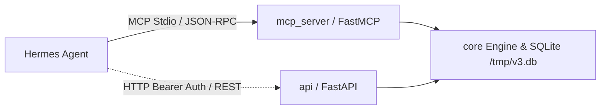

# Интеграция с Hermes Agent через MCP и REST API

В соответствии со спецификацией **SPEC.md v3 (раздел 9)** и решениями архитектуры, Hermes Agent подключается к аналитическому движку ValueBet Engine через официальный протокол **Model Context Protocol (MCP)** по стандартному транспорту `stdio`, либо через REST API.

---

## 1. Архитектура интеграции



- **MCP сервер** (`mcp_server/main.py`) предоставляет компактные инструменты, оптимизированные под контекстное окно LLM (без вываливания громоздких матриц 11×11).
- **Терминология SPEC v3**:
  - Исключены любые намёки на «рекомендации к ставкам» или критерий Келли.
  - Используется объективная формулировка: **«цена выше справедливой»** (+EV) при математическом расхождении с девигованным рынком острых букмекеров.
  - При неоднозначности команд (например, запрос «Манчестер») система возвращает список вариантов для уточнения, не угадывая молча.

---

## 2. Настройка MCP для Hermes Agent

### Конфигурация `hermes.json` / `mcp.json`

Добавьте секцию `valuebet` в конфигурационный файл вашего агента (например, `~/.hermes/hermes.json` или `mcp.json`):

```json
{
  "mcpServers": {
    "valuebet": {
      "command": "uv",
      "args": [
        "run",
        "--directory",
        "/Users/karzhaneuski/projects/valuebet-engine",
        "python",
        "-m",
        "mcp_server.main"
      ],
      "env": {
        "DATABASE_URL": "sqlite:////tmp/v3.db",
        "API_SECRET_TOKEN": "<API_SECRET_TOKEN>"
      }
    }
  }
}
```

### Доступные MCP-инструменты

1. **`get_upcoming_matches(days=3, league=None)`**:
   - Список запланированных матчей с датами, ID и статусом готовности рыночных линий.
2. **`get_match_fair_prices(match_id)`**:
   - Справедливые коэффициенты и вероятности (1X2, Тотал 2.5, Обе забьют, топ-3 вероятных счёта, исход `inny` >4 голов, методологические оговорки).
3. **`evaluate_fortuna_odds(raw_text, match_id=None, team_query=None)`**:
   - Парсинг котировок Fortuna, маржа по секциям (~31% на точном счёте), отметка исходов с «ценой выше справедливой».
4. **`record_user_bet(match_id, market, outcome, odds, stake, bookmaker='Fortuna')`**:
   - Регистрация ставки пользователя для последующего расчёта выигрыша и аудита pre-kickoff CLV.
5. **`get_user_performance(period='all')`**:
   - Прозрачный финансовый аудит: P/L, ROI с 95% bootstrap доверительным интервалом, средний CLV, предупреждение о дисперсии при малой выборке (<100 ставок).
6. **`get_news_brief(home_team, away_team)`**:
   - Фактологическая сводка по подтверждённым потерям и составам в нейтральном тоне.

---

## 3. Резервный доступ через REST API (curl)

Если агент взаимодействует через HTTP-клиент, все эндпоинты (кроме `/health`) защищены Bearer-токеном `API_SECRET_TOKEN`.

### Проверка работоспособности (публичный эндпоинт):
```bash
curl -s http://localhost:8000/health | jq .
```
Пример ответа:
```json
{
  "status": "ok",
  "version": "0.3.0",
  "database_connected": true,
  "last_odds_snapshot_utc": "2026-03-20T10:00:00Z",
  "toa_credits_remaining": 480,
  "search_quota": {
    "period": "2026-03",
    "tavily_credits_used": 14,
    "brave_credits_used": 0
  }
}
```

### Список матчей с авторизацией:
```bash
curl -s -H "Authorization: Bearer test-secret-token" \
  "http://localhost:8000/matches?days=7&league=epl" | jq .
```

### Расчёт справедливых котировок матча:
```bash
curl -s -H "Authorization: Bearer test-secret-token" \
  "http://localhost:8000/matches/1/fair-prices" | jq .
```

### Оценка котировок Fortuna:
```bash
curl -s -X POST -H "Authorization: Bearer test-secret-token" \
  -H "Content-Type: application/json" \
  -d '{
    "match_id": 1,
    "raw_text": "1:0 8.50\n2:0 11.00\n2:1 9.20\n1:1 6.80\ninny 15.00"
  }' \
  "http://localhost:8000/fortuna-eval" | jq .
```

### Регистрация ставки пользователя:
```bash
curl -s -X POST -H "Authorization: Bearer test-secret-token" \
  -H "Content-Type: application/json" \
  -d '{
    "match_id": 1,
    "market": "exact_score",
    "outcome": "1:1",
    "odds": 6.80,
    "stake": 10.0,
    "bookmaker": "Fortuna"
  }' \
  "http://localhost:8000/user-bets" | jq .
```

### Получение статистики пользователя:
```bash
curl -s -H "Authorization: Bearer test-secret-token" \
  "http://localhost:8000/performance?period=all" | jq .
```

---

## 4. Системный промпт Hermes Agent

Рекомендуемый системный фрагмент промпта для Hermes Agent при работе с ValueBet Engine:

```markdown
Вы подключены к аналитическому движку ValueBet Engine.
Ваша цель — предоставлять пользователю объективные математические справки по футбольным котировкам.

ПРАВИЛА:
1. Строго соблюдайте терминологию SPEC v3: используйте формулировку «цена выше справедливой» (+EV).
2. КАТЕГОРИЧЕСКИ ЗАПРЕЩЕНО использовать слово «рекомендация», советовать делать ставки или рассчитывать размер ставки по критерию Келли.
3. Всегда предупреждайте о высокой марже букмекера (~31% на точном счёте) и финансовых рисках.
4. При статистике с выборкой менее 100 ставок обязательно напоминайте о высокой случайной погрешности.
```
