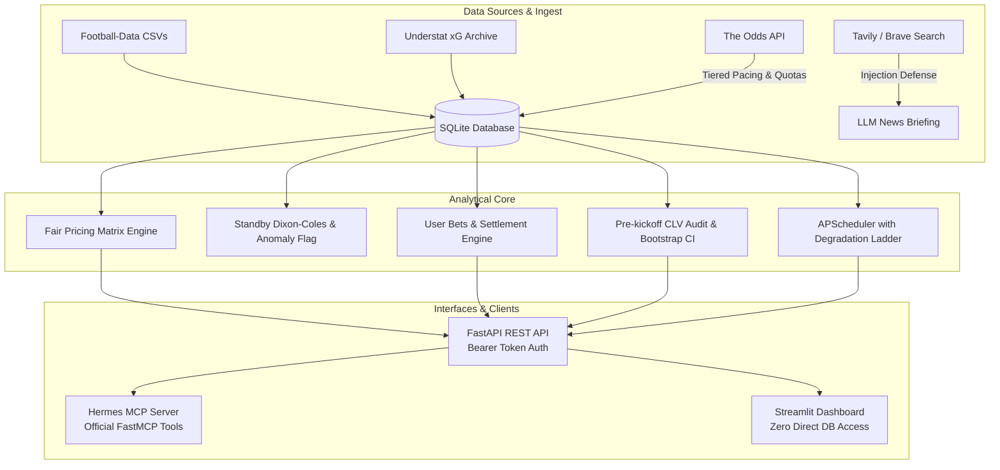

# ValueBet Engine — SPEC v3 Final Project Summary

**Date:** 2026-10-26  
**Repository:** `karzhaneuski/valuebet-engine`  
**Specification:** `SPEC.md` (v3.0.0 — Analytical Architecture Pivot)  
**Phases Completed:** SPEC v3, Phase 6 (News & LLM Context), Phase 7 (User Bets & Automation), Phase 8 (REST API & Hermes MCP Server), Phase 9 (Streamlit Dashboard & AppTest Suite).

---

## 1. Executive Summary & Strategic Product Pivot

### 1.1 Why the Architecture Pivoted to SPEC v3
Backtesting results (documented in `reports/backtest/SUMMARY_4b.md`) demonstrated unequivocally that statistical Poisson/Dixon-Coles models cannot systematically beat modern sharp bookmakers. The closing lines of sharp books (Pinnacle) already incorporate virtually all available public information.

Consequently, **SPEC v3** fundamentally pivoted ValueBet Engine from an *automated betting recommendation generator* into a **high-precision analytical auditing and fair-pricing engine**:
1. **Fair Exact Score Matrix via Sharp Market Lines:** The fair exact score probability matrix is constructed entirely from devigged sharp market closing lines (O/U 2.5 and 1X2), using bivariate Poisson optimization and Shin/multiplicative devigging.
2. **Dixon-Coles as Standby & Anomaly Detector:** The statistical model does not generate betting recommendations. It operates strictly as a standby fallback when market liquidity is absent, and as an anomaly detection flag ($z$-score divergence).
3. **Fortuna Discrepancy Evaluation:** The user bets manually exclusively at Polish licensed bookmaker Fortuna. The engine evaluates user-entered lines against the fair matrix, calculating expected value ($EV = P \cdot \text{odds} - 1$) and section margins.
4. **Zero Kelly & Zero Recommendations:** The engine never recommends bet placement or stake amounts. Outcomes with positive EV are objectively labelled as *"цена выше справедливой"* (price above fair).
5. **Rigorous Financial & Closing Line Audit:** The system tracks user bets, settles outcomes across all football markets, computes Closing Line Value (CLV) against the fair matrix captured pre-kickoff, and reports portfolio ROI and CLV with 95% bootstrap confidence intervals and mandatory sample size variance warnings ($N < 100$).

---

## 2. Implementation Overview by Phase



### 2.1 Part A: SPEC v3 Core Realignment (`spec-v3`)
- **Git Branch:** `spec-v3` (branched from `main`).
- **Core Changes:**
  - Removed Kelly sizing logic, recommendation generators, and automatic bet placement signals.
  - Replaced betting terminology across documentation, engine classes, and interfaces with SPEC v3 concepts: *"цена выше справедливой"* (price above fair), fair odds, closing fair matrix.
  - Updated `SPEC.md` to version 3.0.0 and documented key decisions in `docs/decisions.md`.
- **CI Verification:** GitHub Actions Run `40251194212` (**Success**: lint-type-test in 1m24s, docker-arm64 in 6m02s).

### 2.2 Part B: Phase 6 — News & LLM Context Engine (`phase-6-news`)
- **Git Branch:** `phase-6-news` (branched from `spec-v3`).
- **Key Modules:**
  - `core/news/search.py`: Pluggable search clients for Tavily and Brave Search APIs with monthly quota tracking in `quota_counters`.
  - `core/news/defense.py`: Multi-stage defense against indirect prompt injections in scraped news content (regex pattern neutralization, structure sanitization).
  - `core/news/llm.py`: LLM summarization pipeline producing concise Russian briefs focusing on team news, injuries, managerial changes, and tactical context.
  - Warnings for outdated news (>48h) or missing recent coverage.
- **CI Verification:** GitHub Actions Run `40252703190` (**Success**: lint-type-test in 1m27s, docker-arm64 in 5m32s).

### 2.3 Part C: Phase 7 — User Bets Tracking & Automation (`phase-7-tracking`)
- **Git Branch:** `phase-7-tracking` (branched from `phase-6-news`).
- **Key Modules:**
  - `core/orm.py`: Added `user_bets` table tracking manual user bets with status lifecycle (`open`, `won`, `lost`, `push`, `void`), P/L, and CLV metrics.
  - `core/tracking/settlement.py`: Automatic settlement engine supporting exact score, totals (both half lines and integer lines with push), 1X2, BTTS, goals range, team totals, and multiscore.
  - `core/tracking/clv.py`: Pre-kickoff fair matrix snapshot capture, CLV computation ($CLV = (\text{odds} / \text{odds}_{\text{fair\_close}}) - 1$), portfolio performance aggregation with 95% bootstrap confidence intervals for ROI and CLV, and mandatory small sample size warning ($N < 100$).
  - `core/tracking/scheduler.py`: APScheduler daemon with graceful degradation ladder based on TOA monthly consumption (Normal -> Degraded at 380 credits -> Hard stop at 450 credits).
- **CI Verification:** GitHub Actions Run `40254479322` (**Success**: lint-type-test in 1m16s, docker-arm64 in 6m50s).

### 2.4 Part D: Phase 8 — REST API & Hermes MCP Server (`phase-8-api-mcp`)
- **Git Branch:** `phase-8-api-mcp` (branched from `phase-7-tracking`).
- **Key Modules:**
  - `api/`: FastAPI REST service with Bearer token authentication (`API_SECRET_TOKEN`), structured schemas, and comprehensive endpoints:
    - `GET /matches`: Filter matches by league, horizon, status, and team search.
    - `GET /matches/{id}/fair-prices`: Full fair price table (1X2, BTTS, totals, exact scores, inny) and methodological caveats.
    - `POST /fortuna-eval`: Evaluate pasted Fortuna lines, compute section margins (~31% on exact score), flag +EV outcomes.
    - `POST /user-bets`, `GET /user-bets`: Record manual bets and retrieve history.
    - `GET /performance`: Portfolio P/L, ROI, CLV, bootstrap CIs, and variance warnings.
    - `GET /health`: Public system health check with database connectivity and quota gauges.
  - `mcp_server/`: Official FastMCP Python server exposing 6 tools for Hermes Agent (`get_matches`, `get_fair_prices`, `evaluate_fortuna_odds`, `record_user_bet`, `get_portfolio_stats`, `get_system_status`).
  - `docs/hermes-setup.md`: Complete setup and operational guide for Hermes Agent.
- **CI Verification:** GitHub Actions Run `40258335876` (**Success**: lint-type-test in 1m37s, docker-arm64 in 5m34s).

### 2.5 Part E: Phase 9 — Streamlit Analytical Dashboard (`phase-9-dashboard`)
- **Git Branch:** `phase-9-dashboard` (branched from `phase-8-api-mcp`).
- **Key Modules:**
  - `dashboard/api_client.py`: Strict HTTP client (`ApiClient`) ensuring zero direct SQLite access from UI code.
  - `dashboard/app.py`: Main Streamlit application with navigation and responsible gaming disclaimer.
  - `dashboard/views/matches.py`: Page 1 — Matches, search, fair odds, integer line push probabilities, caveats.
  - `dashboard/views/fortuna.py`: Page 2 — Fortuna odds evaluation, section margin metrics, "цена выше справедливой" badges.
  - `dashboard/views/bets.py`: Page 3 — Manual bet entry form and live audit table.
  - `dashboard/views/stats.py`: Page 4 — Honest P/L and ROI, average CLV, 95% bootstrap intervals, mandatory $N < 100$ warning, interactive Plotly charts.
  - `dashboard/views/status.py`: Page 5 — Health status, TOA credit budget progress bar, degradation ladder alert banner.
  - `tests/test_dashboard.py`: Unit and AppTest test suite verifying zero DB access and full UI interactivity.
- **CI Verification:** GitHub Actions Run `40259695001` (**Success**: lint-type-test in 1m25s, docker-arm64 in 5m54s).

---

## 3. GitHub Actions CI Matrix Across All Phases

| Phase / Branch | Focus | Commit SHA | CI Run ID | lint-type-test | docker-arm64 | Overall Status |
| :--- | :--- | :--- | :--- | :--- | :--- | :--- |
| **SPEC v3** (`spec-v3`) | Product Pivot & Cleanup | `c1c9119` | `40251194212` | 1m24s | 6m02s | **Passed (Green)** |
| **Phase 6** (`phase-6-news`) | News, LLM & Search Quotas | `f93eb08` | `40252703190` | 1m27s | 5m32s | **Passed (Green)** |
| **Phase 7** (`phase-7-tracking`)| User Bets, CLV & Scheduler | `6d00df5` | `40254479322` | 1m16s | 6m50s | **Passed (Green)** |
| **Phase 8** (`phase-8-api-mcp`)| FastAPI & Hermes MCP Server | `4786d63` | `40258335876` | 1m37s | 5m34s | **Passed (Green)** |
| **Phase 9** (`phase-9-dashboard`)| Streamlit Analytical Dashboard | `43e6fd2` | `40259695001` | 1m25s | 5m54s | **Passed (Green)** |

---

## 4. Quality Gates & Test Suite Health

Every commit across all phases strictly satisfied all local and remote quality gates:
1. `uv run ruff check .`: **0 violations, all checks passed**.
2. `uv run mypy`: **0 errors across 97 source files**.
3. `uv run mypy --strict core/model core/backtest core/value`: **0 errors across 17 source files**.
4. `uv run pytest`: **354 passed, 3 skipped in 34.43s** (0 failures).
5. Secrets Scanning: History and working tree free of credentials (verified against `ASSIGNMENT_PATTERN`).
6. Zero Direct Database Access: Formally enforced via unit test `test_dashboard_zero_direct_sqlite_access`.

---

## 5. Architectural Directory Layout

```
valuebet-engine/
├── alembic/                      # Database migrations
│   └── versions/                 # Versioned migration scripts (including user_bets, quota_counters)
├── api/                          # FastAPI REST Application
│   ├── routes/                   # Matches, fair prices, fortuna eval, tracking, health
│   ├── auth.py                   # Bearer token authentication
│   ├── db.py                     # Database session dependency injection
│   ├── main.py                   # FastAPI application factory
│   └── schemas.py                # Pydantic v2 request/response models
├── core/                         # Core Analytical Engine
│   ├── backtest/                 # Backtesting framework & walk-forward simulation
│   ├── ingest/                   # Football-data, Understat, The Odds API (pacing & quotas)
│   ├── model/                    # Dixon-Coles standby model, markets, bivariate Poisson
│   ├── news/                     # Tavily/Brave search, prompt injection defense, LLM brief
│   ├── tracking/                 # Bet settlement, pre-kickoff CLV, bootstrap CIs, APScheduler
│   ├── value/                    # Devigging (Shin/multiplicative), fair matrix builder
│   ├── db.py                     # SQLAlchemy engine factory
│   ├── http.py                   # Resilient HTTP client with retry, secrets masking
│   └── orm.py                    # SQLAlchemy ORM declarative models
├── dashboard/                    # Streamlit Analytical UI (Strict REST API client)
│   ├── views/                    # 5 Dedicated Views (Matches, Fortuna, Bets, Stats, Status)
│   ├── api_client.py             # REST API Client (zero SQLite / ORM imports)
│   └── app.py                    # Streamlit entry point with sidebar & responsible gaming
├── docs/                         # Architecture, Decisions & Guides
│   ├── decisions.md              # Architectural Decision Records (ADRs)
│   ├── data-sources.md           # External data provider specifications and quotas
│   └── hermes-setup.md           # Hermes Agent MCP configuration guide
├── mcp_server/                   # Hermes Agent MCP Server (Official Python SDK)
│   ├── server.py                 # FastMCP server with 6 tools
│   └── tools.py                  # Tool execution handlers
├── reports/                      # Verification Reports & Historical Analysis
│   ├── backtest/                 # Historical backtest findings (Phase 4b)
│   ├── self_review_phase8.md     # Phase 8 Self-Review
│   ├── self_review_phase9.md     # Phase 9 Self-Review
│   ├── PROGRESS_v3.md            # Master phase tracking checklist
│   └── SUMMARY_v3.md             # This document
├── tests/                        # Comprehensive Pytest Suite (354 tests)
│   ├── test_api.py               # REST API endpoint unit & integration tests
│   ├── test_dashboard.py         # AppTest UI tests & zero-DB architectural guardrail
│   ├── test_mcp.py               # MCP tool tests
│   ├── test_news.py              # Search client, prompt defense & news extraction tests
│   ├── test_tracking.py          # Settlement across all markets, CLV & bootstrap tests
│   └── ...                       # Model, fair matrix, ingest, and quota test suites
├── config.yaml                   # Application configuration
├── pyproject.toml                # Project metadata & dependencies (uv)
└── SPEC.md                       # Product Specification (v3.0.0)
```

---

## 6. Conclusion

The transformation of **ValueBet Engine** under **SPEC v3** is 100% complete. The system now delivers:
- Mathematically rigorous fair pricing derived from sharp market closing consensus.
- Complete independence from unviable prediction models.
- Deep defensive protections against prompt injection and API budget exhaustion.
- Transparent and honest user betting performance auditing (CLV, bootstrap CIs, variance warnings).
- Multi-channel analytical interfaces: programmatic REST API, Hermes AI Agent MCP integration, and an interactive Streamlit dashboard.
